# UR FINKEL — feature guide

A tour of the game in pictures: what each part is, why it exists, and how it
fits the whole. The pictures were taken on 2026-10-20 by
[`tools/feature-guide.mjs`](../tools/feature-guide.mjs), which serves the play
page ([`docs/index.html`](index.html)) locally, presses **Play**, and plays
through the game the way a visitor would: the cabinet, the rules, a whole
match against URBOT, a real-lots match left with `x x x`, and the demo. Every
key went in through the page's own on-screen keys; the name was typed as
keystrokes aimed at the emulator, as the page's SEND button does.

> **What was real and what was not.** The game, the emulator and the match
> are real: build 2026.09.2711 of `build/urfinkel.prg`, running in the
> EmulatorJS/VICE build vendored in `vendor/emulatorjs/`, with nothing fetched
> from the network (the same substitution `tools/dist.sh` makes for the
> offline copy). The player "paul" was **the script**, choosing its pieces by
> a simple habit (bear off if it can, else land on a rosette, else move the
> piece that goes furthest); URBOT played as it always does. Pictures 17 and
> 18 come from a second, short session the same day. The match is random, so
> running the script again gives a different game and different pictures.
> The moving pictures (GIFs) are not from this run: they are the repo's own
> recordings in [`docs/media/`](media/), made by `make media` under VICE.

Each Plus/4 picture is the emulator's own 384×288 frame, enlarged three times
with no smoothing, so every machine pixel is a 3×3 block. Numbered rings
match the numbered notes beside them and under them.

## Contents

1. [The way in: a Plus/4 inside a web page](#part-1)
2. [The cabinet](#part-2)
3. [How we play: the Finkel ruleset, as the machine referees it](#part-3)
4. [Setting up a match: the mode, a name, a colour](#part-4)
5. [The board and the opening throw](#part-5)
6. [A turn: the lots, the legal moves, and whose turn it is](#part-6)
7. [URBOT, the opponent that thinks aloud](#part-7)
8. [The events: a rosette, a piece borne off, a capture](#part-8)
9. [The end of a match](#part-9)
10. [Real lots, and leaving with x x x](#part-10)
11. [The demo](#part-11)
12. [The keyboard, and the real machine](#part-12)
13. [How it fits together](#part-13)

## 1. The way in: a Plus/4 inside a web page

**Why it exists.** UR FINKEL is a program for the Commodore Plus/4, which few
people own. The play page boots a Commodore Plus/4 inside the browser and runs
the game on it, so it can be played with nothing installed and nothing
downloaded by hand.

**How it fits.** The page is a host and nothing more: the same
`urfinkel.prg` runs here, in VICE, YAPE and plus4emu, and on a real Plus/4.
Everything from part 2 onwards happens on the emulated machine.

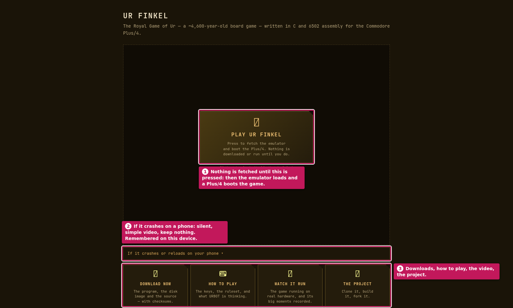

*The play page before Play is pressed.*

1. Nothing is fetched until this is pressed: then the emulator loads and a
   Plus/4 boots the game. The README says to give it up to two minutes.
2. "If it crashes or reloads on your phone": three switches, remembered on
   that device: **silent** (no sound, and half the audio work), **simple
   video** (the lighter build of the emulator), and **keep nothing** (do not
   store the emulator on the device). The tour used "keep nothing".
3. The rest of the page: downloads with checksums, how to play, the video,
   and the project.

The page loads the emulator only on a press, and after a crash it comes back
to a quiet page with the button on it, never to a second attempt by itself:
an emulator is a large WebAssembly program, and on an iPhone running it on
every visit was a reliable way to lose the tab. A watchdog notices when the
emulated machine stops producing frames and says so, and **Unload** is a
reload, because that is the one thing that ends an emulator, its memory and
its sound together.

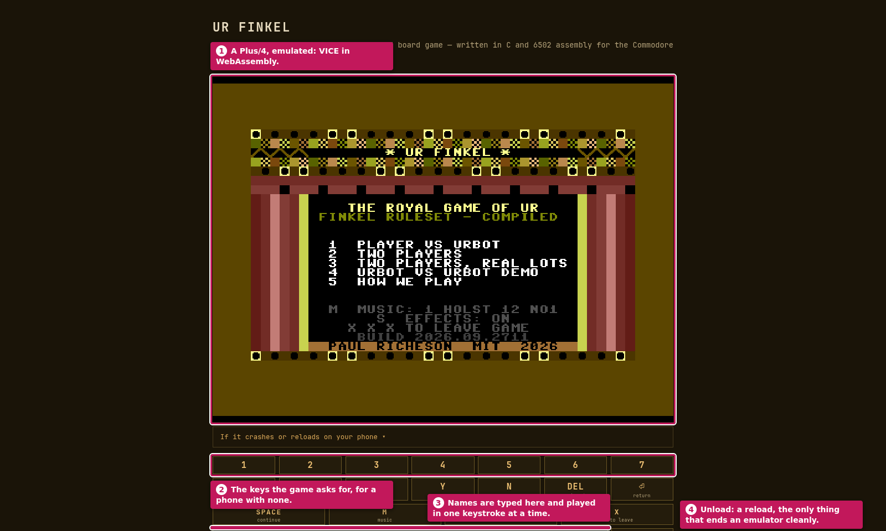

*The page with the game running, and the on-screen keys.*

1. A Plus/4, emulated: VICE in WebAssembly (EmulatorJS 4.2.3, GPL, shipped
   alongside and not part of UR FINKEL).
2. The keys the game asks for, as buttons, for a phone with no keyboard:
   `1`–`7`, `8 9 0`, `Y`, `N`, `DEL`, return, space, `M`, `S` and `X`. The
   emulator's own on-screen control is a joystick, which this game never reads.
3. Names are typed in this box and played into the machine one keystroke at a
   time, ending on return.
4. Unload the emulator.

**Check yourself**

- [ ] Do you know where the three "if it crashes" switches are, before you need them?

## 2. The cabinet

**Why it exists.** A game that boots to a bare menu says nothing about what it
is. UR FINKEL boots into a theatre: a laser cuts the title, the curtains open
on a royal fanfare, and the choices scroll up into the open stage. Left alone
for two minutes, the cabinet starts playing by itself.

**How it fits.** Every match starts and ends here. The curtains close before
the scene behind them changes, so the board never appears by cutting.

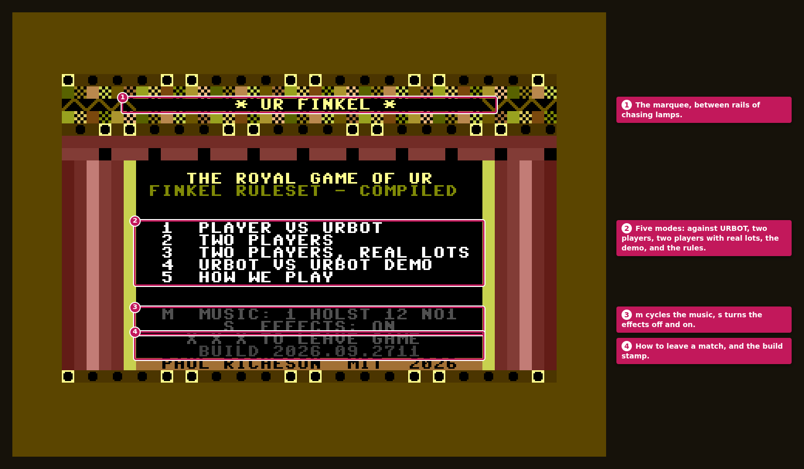

*The cabinet, after the curtains have opened.*

1. The marquee, between frieze bands and rails of chasing lamps.
2. Five modes: against URBOT, two players, two players with real lots, the
   URBOT demo, and the rules.
3. `m` cycles the music, including the generated bed and silence;
   `s` turns the sound effects off and on.
4. How to leave a match, and the build stamp, so a download can be
   identified from the machine itself.

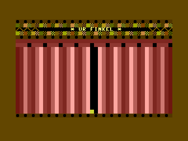

*The curtains opening, recorded by `make media` (from the repo).*

The music is a 200 Hz raster interrupt and a 50 Hz sequencer that every wait
in the game calls, so it keeps playing while the game waits for you. TED has
two tone voices and one global volume, so chords are arpeggiated and the
volume never moves; the full design is in [music.md](music.md).

## 3. How we play: the Finkel ruleset, as the machine referees it

**Why it exists.** The rules are the ones Irving Finkel reconstructed from a
Babylonian tablet. The machine referees them, so nobody has to learn them
first, but `5` on the menu shows them on one screen, with the path drawn on
the board itself.

**How it fits.** `src/rules.c` holds the ruleset with no Plus/4 in it, so
`make check` runs the frozen BASIC edition's thirteen rule cases against it
on the host in milliseconds. 13 of 13 pass.

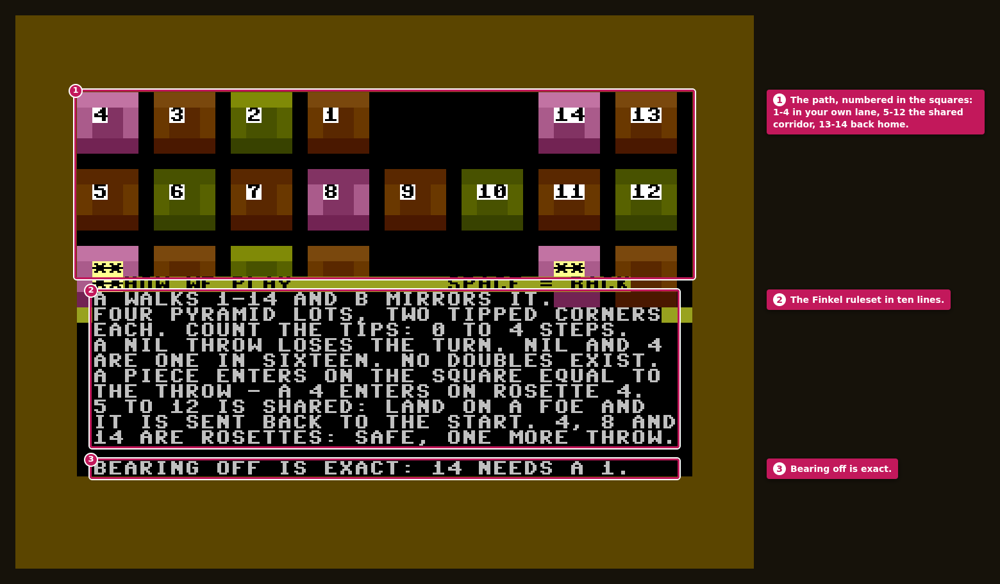

*The rules screen (`5` on the menu; space returns).*

1. The path, numbered in the squares: each side walks 1 to 14, and the other
   side mirrors it.
2. The Finkel ruleset in ten lines.
3. Bearing off is exact: from 14, only a 1 takes a piece home.

The rules as `src/rules.c` and the rules screen implement them:

| Rule | As implemented |
| --- | --- |
| Pieces | Seven a side, all starting off the board. Bring all seven home to win. |
| The lots | Four tetrahedral lots, each with two tipped corners. The throw is the number of tips showing, 0 to 4: four coin flips summed, so 0 and 4 are one in sixteen and 2 is six in sixteen. There are no doubles. |
| A nil throw | 0 loses the turn. So does a throw with no legal move. |
| Entering | A piece enters on the square equal to the throw; a 4 enters on the rosette at 4. |
| The corridor | Squares 5 to 12 are shared. Land on an enemy piece there and it goes back to the start. Squares 1–4 and 13–14 are private: pieces there never meet. |
| Rosettes | Squares 4, 8 and 14. Landing on one gives another throw. The middle one, 8, is the only shared rosette, and a piece on it cannot be taken: nobody may land there while the other side holds it. |
| Blocking | No piece may land on a square its own side already holds. |
| Bearing off | Home is step 15, and the count must be exact: no overshooting. |
| Who opens | Each side throws the four lots; the higher hand opens, and a tie is thrown again. |

**Check yourself**

- [ ] You have a piece on 13 and throw a 3. Can it go home? (No: 13 needs exactly 2.)
- [ ] An enemy piece sits on 8. Can you capture it with an exact throw? (No: it is safe there, and you may not land on it.)

## 4. Setting up a match: the mode, a name, a colour

**Why it exists.** A menu that just vanishes when a key is pressed gives no
sign of *which* thing was chosen. So the choice is read back: a chime, the
mode's name cut by the laser, a line saying what it is. Then the game asks for
a name (it goes on the board, in the chronicle, and on the trophy) and a
colour, chosen by seeing it rather than by number alone.

**How it fits.** Against URBOT, the machine is player one on the far side of
the board and you are the near side, as across a real table. URBOT's colour is
derived from yours. "Play again" after a match keeps both names and colours.

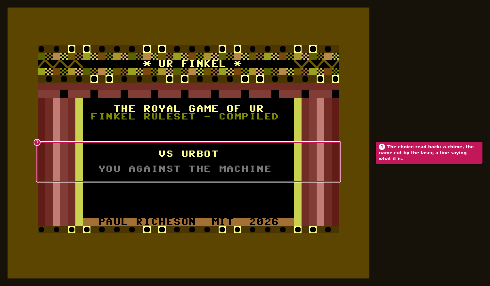

*The choice read back: `1`, "vs urbot", "you against the machine".*

1. The choice read back: a chime, the name cut by the laser, a line saying
   what it is, then a rising run under the closing curtain.

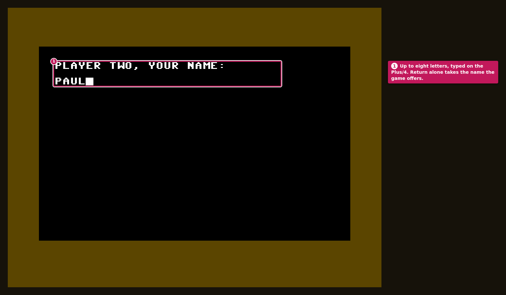

*The name prompt, with "paul" typed.*

1. Up to eight letters: eight is what fits across the screen when the
   winner's name is cut in block letters. `DEL` rubs out;
   return alone takes the name the game offers.

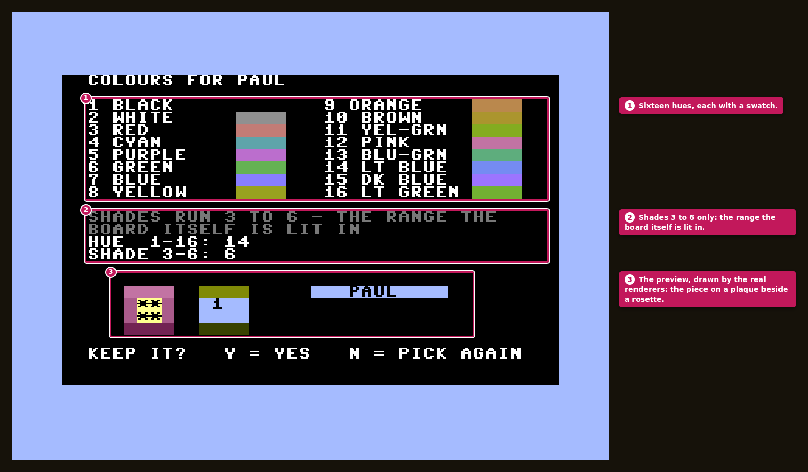

*The colour picker: hue 14 (light blue), shade 6.*

1. Sixteen hues, each with a swatch.
2. Shades 3 to 6 only: the range the board itself is lit in. Outside it a
   piece either sinks into its tile or competes with the rosette gold.
3. The preview, drawn by the real renderers: a piece on a plaque beside a
   rosette, and the name. `y` keeps it, `n` picks again.

## 5. The board and the opening throw

**Why it exists.** The board is the whole game, so it is drawn to be read at a
glance: a black grid of 4×4-cell tiles, the rosettes in gold, each side's
plaque with its seven pieces waiting, and the four-line **chronicle** below,
which says what just happened and why.

**How it fits.** The top band is URBOT's private lane, the bottom band yours,
the middle the shared corridor. Everything the game says goes through the
chronicle, which scrolls and can repaint itself, which is what lets the big
moments take over the bottom of the screen and give it back.

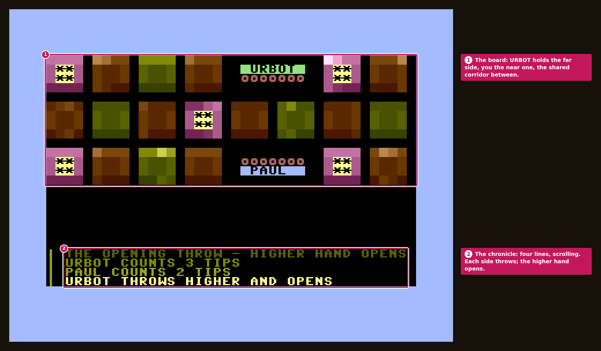

*The board, and the opening throw.*

1. The board: URBOT on the far side, you on the near one, the shared
   corridor between. The waist plaques hold the names and the pieces still
   to enter.
2. The chronicle: each side throws the lots, the higher hand opens.

Over the tiles runs the **shimmer**: on every tile a bright point travels
round the face, which reads as a curved surface catching a moving light. It
touches only the top and bottom rows of each tile, never the pieces, and is
colour memory only.

## 6. A turn: the lots, the legal moves, and whose turn it is

**Why it exists.** A turn has three questions: whose turn is it, what was
thrown, and which pieces may move. The game answers the first in light, the
second with the lots themselves, and the third with a list, so the only thing
a player ever types during a match is the number of the piece.

**How it fits.** The machine works out the legal moves (`find_legal_moves`,
577 times faster than the BASIC edition) and refuses any other key with an
error sound. The speed of the compiled edition was spent here: lots that
tumble for sixteen to twenty-one frames, and pieces that glide one character
cell at a time.

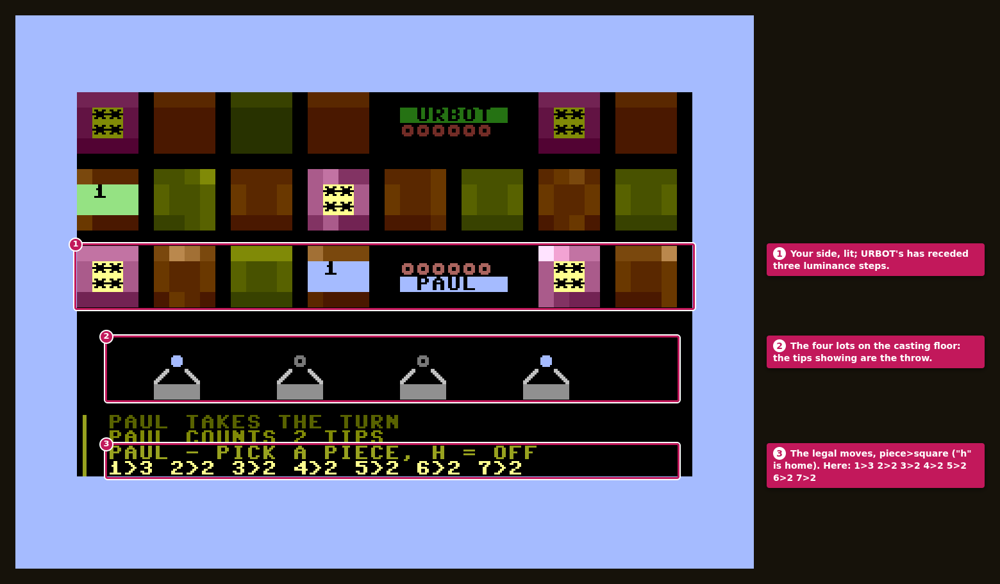

*Your turn: the lots, and the legal moves.*

1. Your side, lit. The side not to move recedes three luminance steps
   (squares, plaque and piece count), and the shimmer stops crossing it.
   Between turns, the border and background run a six-step gradient in the
   incoming player's colour while a short cheer plays.
2. The four lots on the casting floor: the tips showing are the throw.
3. The legal moves, piece>square, `h` for home. Press the piece's number.

| | |
| --- | --- |
| 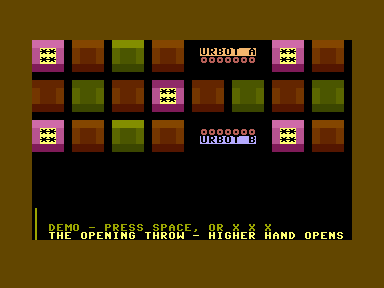 | 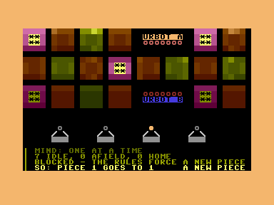 |
| The lots tumble and land (repo recording). | A piece travels a cell at a time; the square it leaves goes black and flashes, the one it reaches flashes and takes the mover's colour (repo recording). |

**Check yourself**

- [ ] Can you tell whose turn it is without reading a word? (The lit side, and the border colour.)

## 7. URBOT, the opponent that thinks aloud

**Why it exists.** A machine opponent that only moves teaches nothing. URBOT
says what it is thinking: the doctrine it is playing, a census of its pieces,
the rule that decided, and the move. Each side draws one of four doctrines at
random at the start of a match, and draws again once three of its pieces are
home, because an endgame wants different play.

**How it fits.** URBOT is a port of the frozen BASIC edition's player: one
pass over the legal moves fills five registers (a piece that can bear off,
capture, take a rosette, enter, or lead), and each doctrine is a priority
order over them. If no rule fires, it picks a legal piece at random, so it
can never stall.

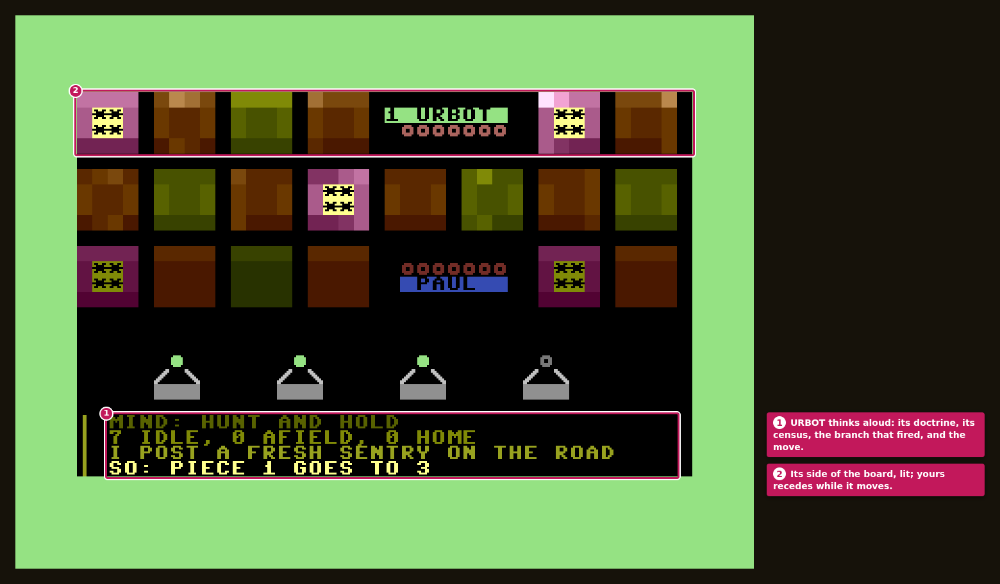

*URBOT, thinking aloud. This match it drew "hunt and hold".*

1. Its doctrine, its census (idle, afield, home), the branch that fired, and
   the move: "i post a fresh sentry on the road / so: piece 1 goes to 3".
2. Its side of the board, lit; yours recedes while it moves.

| Doctrine | Priority, first that applies |
| --- | --- |
| one at a time | bear off; capture if the lead piece can; drive the lead piece; open on a rosette; enter a new piece |
| fill the board | capture; enter a new piece; take a rosette; bear off; move the lead piece |
| run for it | bear off; move the furthest piece; take a rosette; capture; enter |
| hunt and hold | capture; take and hold a rosette; bear off; stalk forward; enter |

## 8. The events: a rosette, a piece borne off, a capture

**Why it exists.** Three things change a race: a rosette (another throw), a
piece reaching home, and a capture (an enemy piece sent back to the start).
The two that stop the game take the whole bottom of the screen, the casting
floor and the chronicle both, for as long as the moment needs and no longer.

**How it fits.** These are the rule engine's three reports (`mv_rosette`,
bearing off, `mv_captures`) turned into sound and pictures by
`src/etch.c`: the laser, the block font and the fire.

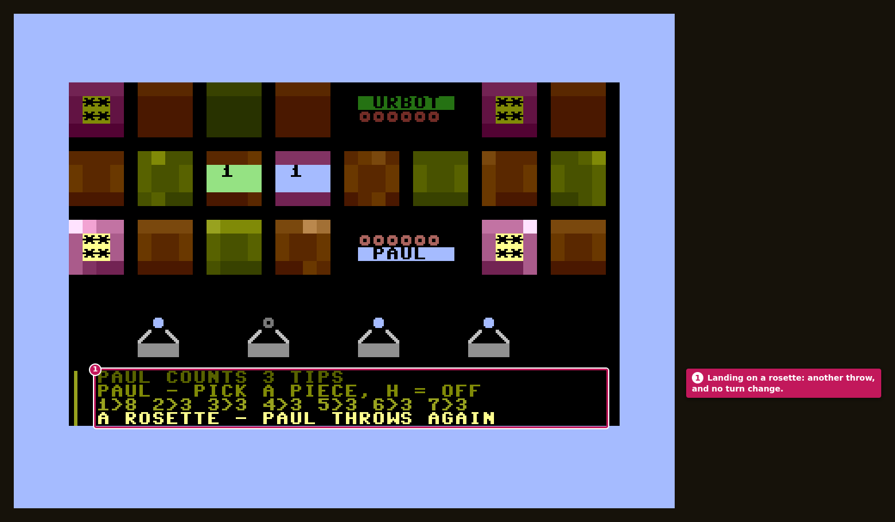

*A rosette: "a rosette - paul throws again".*

1. Landing on a rosette: another throw, and no change of turn.

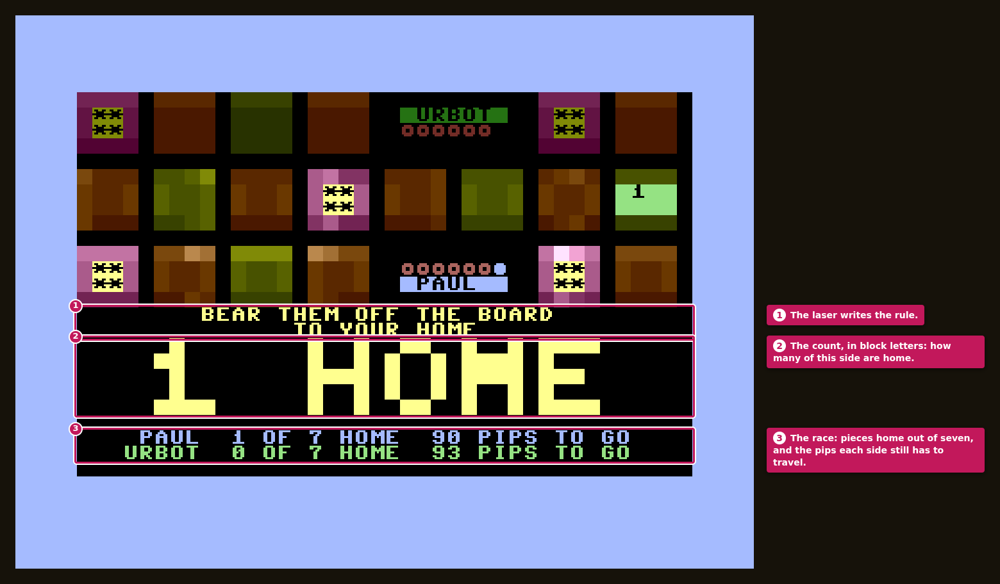

*A piece borne off: paul's first.*

1. The laser writes the rule: "bear them off the board / to your home".
2. The count, in block letters: how many of this side are home, *1 home* to
   *7 home*.
3. The race: pieces home out of seven, and the pips each side still has to
   travel (a side starts on 105 and has won at 0). Here: paul 90, URBOT 93.

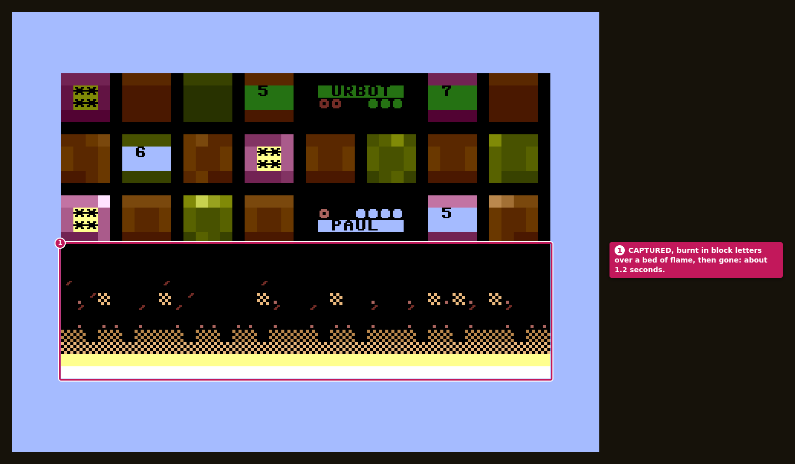

*A capture: "paul captures a foe on 6", caught as the fire dies down.*

1. CAPTURED is burnt in block letters over a bed of flame along the bottom
   six rows, the ignition climbing from the bottom, and then it goes out. It
   lasts about 1.2 seconds, because it happens several times a match.

The fire is fast enough that the tour caught only its last frames. The
repo's recording shows the whole of it:

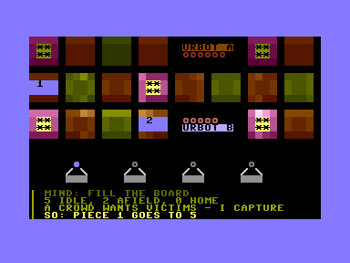

*The whole burn (repo recording).*

## 9. The end of a match

**Why it exists.** A win is the one moment in a match nobody is in a hurry.
The border flares, the theme plays, the board is **kept** so the winner can
look at the position that won, and the winner's name is cut at the size of
the screen, then poured into a gold cup, then fireworks.

**How it fits.** The end is where the name from part 4 comes back. Space
continues; "play again?" keeps the same two players and colours on a fresh
board, or `n` returns to the cabinet. In the demo nobody presses anything, so
it looks at the cup for a few seconds and goes back to the cabinet by itself.

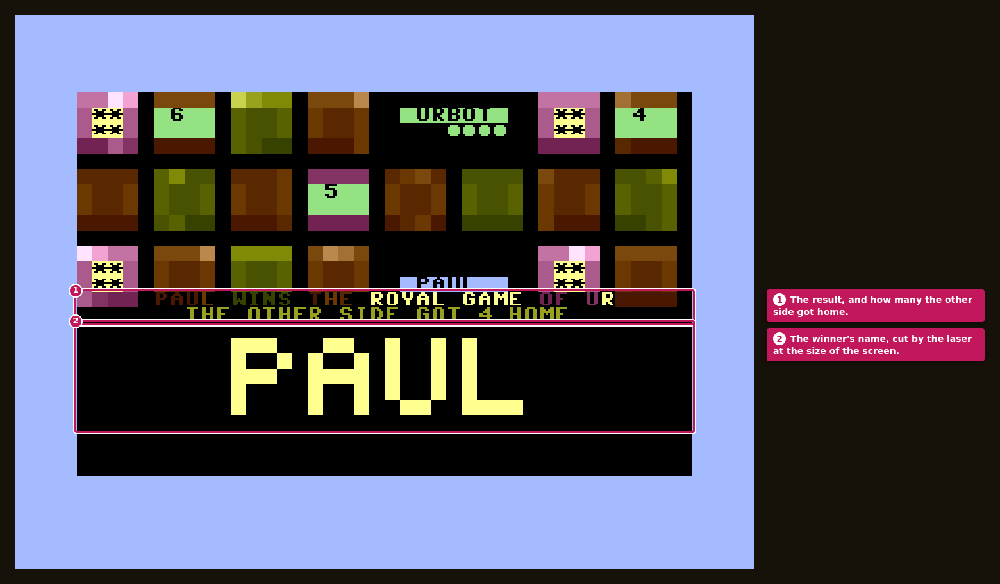

*The winner's name, cut by the laser. paul won this match, 7 to 4.*

1. The result, and how many the other side got home.
2. The name in block letters at a five-column pitch: eight letters span
   thirty-nine of the forty columns, which is why a name is eight letters.

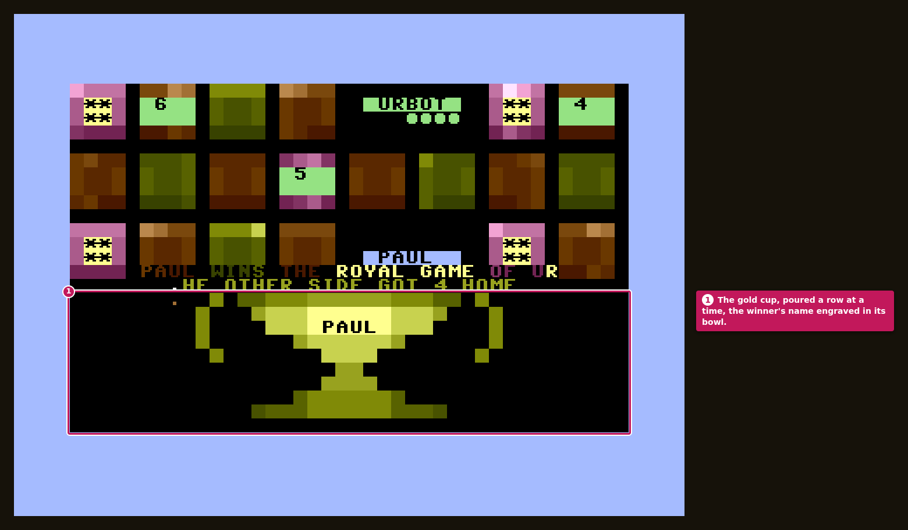

*The cup.*

1. The gold cup, poured a row at a time, the winner's name engraved in its
   bowl.

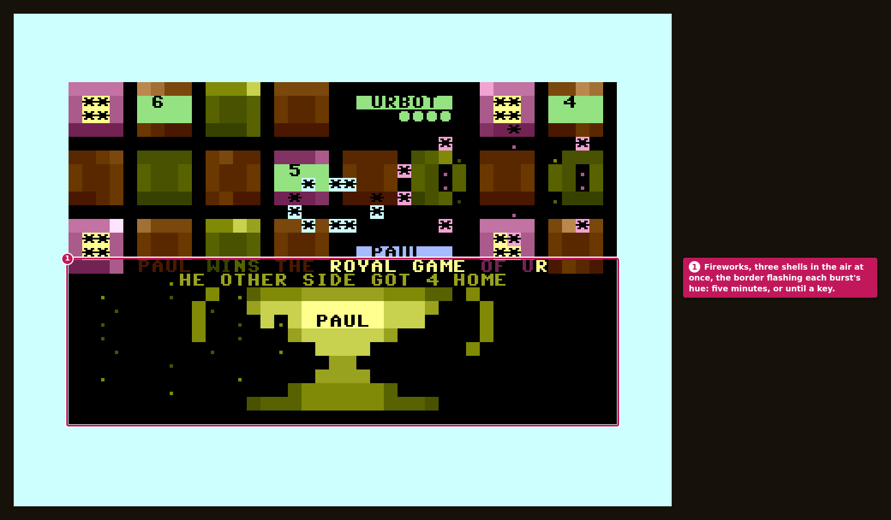

*Fireworks.*

1. Three shells in the air at once, the border flashing each burst's own hue.
   They run for five minutes by the clock, or until any key.

> **Seen while making this guide.** In the headless browser, a single tap of
> the page's on-screen space key (it holds the key 120 ms) did not end the
> fireworks; a key held for half a second did. The fireworks loop reads the
> keyboard only between shells, and the keyboard driver wants a key down on
> two consecutive scans. Whether a phone tap is affected on real devices was
> not tested.

## 10. Real lots, and leaving with x x x

**Why it exists.** Some people own a set of lots, or want to. Mode 3 is two
players at the keyboard who throw their own lots at the table and type the
count; the machine still referees everything else. And any match can be left:
`x` three times in a row returns to the cabinet, and any other key resets the
count, so a stray `x` cannot end a game.

**How it fits.** Manual throws replace only `throw_lots`; the moves, rules,
captures and the end are the same code. The `x` count is checked at every
prompt and between URBOT's moves.

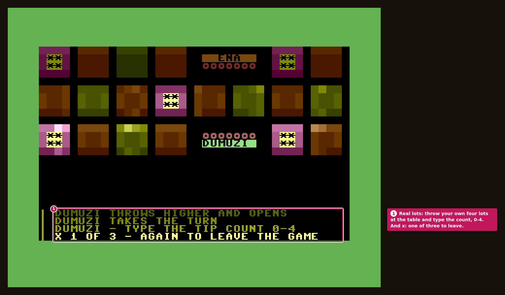

*A real-lots match between the default names "ena" and "dumuzi", with `x`
pressed once (second session).*

1. "type the tip count 0-4", then `x`: "x 1 of 3 - again to leave the game".

## 11. The demo

**Why it exists.** A cabinet that only waits is not an attraction. Mode 4,
and two idle minutes on the menu, start URBOT A against URBOT B, each with a
doctrine drawn at random, narrating as it goes. Sound effects are off in a
demo (the music stays); space, or `x x x`, ends it.

**How it fits.** The demo is the same game loop with two URBOTs. It is also
how the repo's GIFs are recorded (`make media`) and how `make test` checks the
program is running.

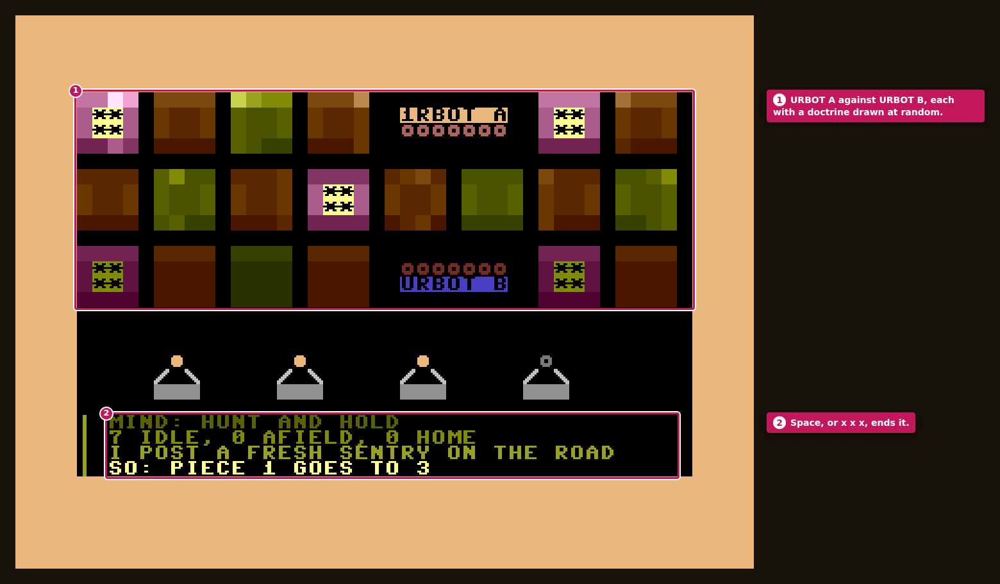

*The demo (second session).*

1. URBOT A against URBOT B, each with its own doctrine.
2. The chronicle narrates every move; space or `x x x` ends it.

## 12. The keyboard, and the real machine

**Why it exists.** Under cc65 the Plus/4's KERNAL interrupt that normally
scans the keyboard does not run, so the usual way of reading a key can never
return one. `src/kbd.c` reads TED's keyboard matrix directly ($FD30 and
$FF08), once a frame, with a 40 ms debounce and a buffer, so keys pressed
during an animation are still there when the game next asks.

**How it fits.** Every key in this guide went through that driver, whether it
came from the page's buttons, a desktop keyboard in the browser, or a real
Plus/4. `make check` runs 26 keyboard assertions on the host with only the
matrix read faked; the fault trace is in
[keyboard-lab-report.md](keyboard-lab-report.md).

The same program runs off the web page too (see [INSTALL.md](../INSTALL.md)):

| Where | How |
| --- | --- |
| A real Plus/4 | `urfinkel.d64` on an SD2IEC, then `dload"urfinkel"` and `run`. Run on a restored PAL Plus/4 on 2026-08-07: the project's first, and so far only, hardware validation. |
| VICE, YAPE, plus4emu | Open `urfinkel.prg` or `urfinkel.d64`. `make run` builds and boots it in `xplus4`. |
| Another web emulator | Load either file at plus4.cybernoid.xyz. |
| Offline | `urfinkel.zip` carries the program, the disk image, the source, this play page and the emulator; `./start-html.sh` serves it. |

## 13. How it fits together

**Why it exists.** UR FINKEL is the compiled edition of a complete, frozen
BASIC game. The BASIC edition took 24 seconds to draw the board; the compiled
one takes 123 ms, and the time saved was spent on the things in this guide.

**How it fits.** Each part exists because the one before it is not enough on
its own.

| Stage | Feature | Why it is not enough alone |
| --- | --- | --- |
| Reach | The play page, the downloads, the offline zip | A Plus/4 program nobody can run is not played. |
| Arrive | The cabinet, the music, the demo | A menu says what can be done, not what the thing is. |
| Learn | The rules screen | Rules on a screen are not enforced; the referee does that. |
| Referee | `rules.c`, the legal-move list, the chronicle | A correct game that does not show its reasoning is a black box. |
| Oppose | URBOT and its four doctrines | An opponent that only moves teaches nothing; this one says why. |
| Mark the moments | The rosette, the laser, the fire, the race count | The events that change a race need to be seen, but briefly. |
| Finish | The name, the cup, the fireworks, play again | The end returns the name from the start and offers the rematch. |
| Underneath | The keyboard driver, the raster interrupt, `make check` and `make conform` | None of it shows, and every picture above depends on it. |
